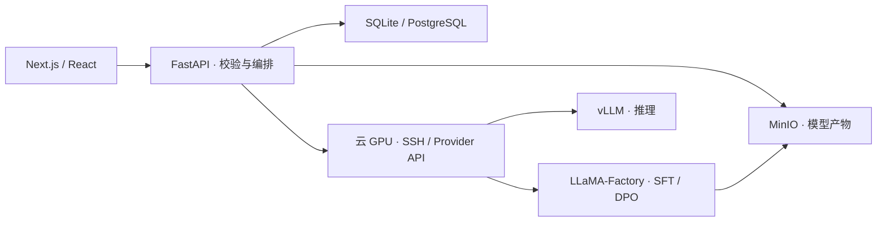

# 训推平台 · Xuntui Platform

基于 **Next.js + FastAPI** 的模型训练与推理管理平台，将数据集管理、SFT / DPO 微调、模型产物管理和推理服务串成可追踪的工作流。

支持本地开发与远程 GPU 执行，提供任务状态、运行日志及模型产物管理。仓库包含运行配置、回归测试与样例数据；实际训练和推理需自行配置模型、GPU 与相应运行环境。

## 核心能力

| 模块 | 实现内容 | 主要代码 |
| --- | --- | --- |
| 数据集管理 | JSONL 上传、格式校验、预览、发布与修复；区分 SFT / DPO | `components/dataset-repair-panel.tsx`、`backend/app.py` |
| 训练编排 | 任务参数校验、排队、状态跟踪、日志与指标；对接 LLaMA-Factory | `backend/llamafactory.py`、`backend/training_executor.py` |
| 远程 GPU | 云端实例申请、SSH 执行、日志跟随、异常恢复和资源保留/清理 | `backend/providers/youyun/` |
| 模型管理 | Best / Final Adapter、运行目录与备份状态分离、MinIO 上传/恢复 | `backend/model_storage.py`、`backend/training_artifacts.py` |
| 推理服务 | 服务状态与日志、流式生成、模型路径解析及 vLLM 接入 | `backend/inference_service.py`、`backend/providers/youyun/inference.py` |
| 持久化 | SQLite 本地模式，PostgreSQL 共享存储，审计与清理机制 | `backend/store.py`、`backend/postgres_storage.py` |

## 架构概览



具体职责和边界见 [ARCHITECTURE.md](ARCHITECTURE.md)。代码导览见 [开发指南](docs/CODE_GUIDE.md)。

## 本地启动：不需要 GPU

前置条件：**Node.js 22、Python 3.11+**。以下命令均在仓库根目录执行。

### 1. 获取代码并创建配置

```bash
git clone https://github.com/silentfire123/cppt-platform.git
cd cppt-platform
```

复制 `.env.example` 为 `.env`：Windows PowerShell 使用 `Copy-Item .env.example .env`，Linux/macOS 使用 `cp .env.example .env`。

示例配置默认使用 SQLite、关闭登录门禁和本地 ML 执行，并绑定本机地址。**关闭门禁仅用于本地查看，不要直接暴露到公网。**

### 2. 启动后端

```bash
python -m venv .venv
# Windows PowerShell: ./.venv/Scripts/Activate.ps1
# Linux/macOS: source .venv/bin/activate
python -m pip install -r requirements-storage.txt
python scripts/run_backend_linux.py
```

`run_backend_linux.py` 不依赖 WSL，也可以在原生 Windows Python 下运行。另一个 `npm run backend` 命令是原项目的 Windows + WSL 专用入口，不是上述通用启动方式。

### 3. 新终端启动前端

```bash
npm ci
npm run dev -- --hostname 127.0.0.1 --port 3100
```

- 前端：<http://127.0.0.1:3100>
- 健康检查：<http://127.0.0.1:8010/api/health>
- 交互式接口文档：<http://127.0.0.1:8010/docs>

无 GPU / 云凭证时可查看界面、数据结构与 API；云端目录、训练提交和推理启动等功能需要额外配置。MinIO 未配置时对象存储相关功能不可用，不能据此视为备份成功。

## 测试与构建

```bash
npm run test:frontend
npx tsc --noEmit
npm run build
python -m unittest discover -s backend -p "test_*.py"
python -m compileall -q backend scripts
```

后端 API 测试额外需要 `httpx`，可通过 `python -m pip install httpx` 安装。常规单元测试不要求启动真实 GPU 任务。真实云端验收脚本不是单元测试，运行前必须检查凭证、实例和费用。

## 真实训练与部署的边界

- 远程 GPU 需要配置 `YOUYUN_*` 凭证、地域与可用镜像，并准备适配的模型及运行环境。
- 本地 ML 路径需另行安装 LLaMA-Factory / PyTorch / vLLM；根目录的可选 runtime requirements 与 API 依赖分开，不属于默认启动流程。
- `compose.production.yml` 提供 API/前端容器化模板；需要自行准备 PostgreSQL、MinIO 和 `.env.production`，不包含云资源一键开通。
- `.env.production.example` 只有占位配置。对外部署前必须配置认证、HTTPS、网络访问控制和备份策略。
- 当前主流程聚焦单 GPU 的文本生成微调；分布式配置与评测相关代码不等于已经交付完整的多机训练或正式评测系统。
- 样例数据仅用于格式和链路演示，不支持任何效果或性能结论。

## 目录

```text
app/                    主应用入口与样式
components/             数据集、训练、模型管理、推理等界面
lib/                    前端类型、状态处理与回归测试
backend/                FastAPI、存储、训练编排、Provider 与后端测试
data/qwenruozhi_v1/      小型合成 SFT 样例（保留旧 ID 兼容接口）
test-data/              DPO / checkpoint 回归样例
scripts/                启动、数据转换与手动验收工具
deploy/docker/          前后端 Dockerfile
docs/CODE_GUIDE.md       代码导览、设计要点与运行检查
```

真实密钥、环境文件、数据库、模型权重、缓存及日志不纳入版本控制。
